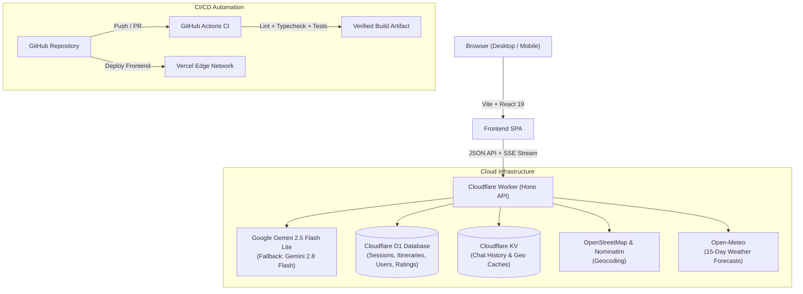

# Rute — AI Travel Planner

[Versi Bahasa Indonesia](README.md) | [**English**](README.en.md)

[](https://github.com/NAxel-code/AI-Travel-Chatbot/actions/workflows/ci.yml)
[](https://nodejs.org/)
[](https://workers.cloudflare.com/)
[](https://react.dev/)
[](https://tailwindcss.com/)

A bilingual (Indonesian & English) intelligent itinerary planner that transforms natural conversations into structured, realistic, and departure-ready multi-day travel plans. Powered by **Google Gemini AI**, **Google Maps & OpenStreetMap** geospatial databases, **Open-Meteo** live weather forecasts, a transparent budget calculator, and **Cloudflare D1 & KV** cloud persistence.

---

## 📸 Latest User Interface (UI Showcase)

Crafted with the **Hallmark** editorial design ethos and **UI-UX-Pro-Max** standards without *AI-slop*, delivering a tactile and responsive experience in both light and dark themes.

### 1. Light Theme (Sand & Sea Palette)

*Desktop view in warm light mode (`#faf8f4`): Quick action navigation, structured daily cards with verified Google Maps ratings, 1-click directions, and AI assistant consultation.*

### 2. Dark Theme (Obsidian Dark Palette)

*Desktop view in obsidian dark mode (`#0c0f12`): High contrast (4.5:1+), eye-friendly for evening planning, equipped with memory indicators and integrated PDF export.*

---

## ✨ Key Features & Capabilities

### 1. Consultative AI Assistant & Fast Streaming
- **Server-Sent Events (SSE)**: Gemini responses and real-time execution steps (*grounding places, weather estimates, route calculation*) stream smoothly in milliseconds without UI freezes.
- **Intelligent Context Detection**: Automatically extracts destination, trip length, group size, and travel style preferences (budget, halal culinary, child-friendly, backpacker).
- **Single-Day Customization**: Request modifications for a specific day (e.g., *"Adjust Day 2 schedule for indoor activities due to rain"*) without regenerating the entire trip.

### 2. Real Place Grounding & Google Maps Ratings
- **Curated Geospatial Data**: Hundreds of real tourism landmarks, scenic viewpoints, and dining spots across Indonesia with exact latitude/longitude coordinates.
- **Public Ratings & Reviews**: Each activity card features verified star ratings (*Google Maps*) and review counts.
- **1-Click Navigation**: Direct button to launch turn-by-turn routing in your phone's Google Maps app.
- **Culinary Anti-Repetition**: Guarantees varied dining options for every meal without boring duplicates.

### 3. Light & Obsidian Dark Mode Toggle
- **Two Curated Palettes**: Warm alabaster *Sand & Sea* and deep *Obsidian Dark* (`#0c0f12`, `#141920`, `#1a212b`).
- **Automatic Preference Persistence**: Automatically respects OS preference (`prefers-color-scheme`) and persists manual selection in `localStorage`.
- **WCAG AA Contrast Ratio**: Meets accessibility standards with 4.5:1+ contrast across all cards, buttons, text, and modals.

### 4. Interactive On-Screen Spotlight Tour
- **Native Spotlight Cutout**: Guided on-screen tour using dynamic *box-shadow cutout* and glowing *pulse beacon* without bloated third-party dependencies.
- **5 Guided Steps**:
  1. *AI Chat Composer* — Describe your dream vacation.
  2. *Integrated Workspace* — Read daily timelines and activity hours.
  3. *Budget Calculator* — Transparent cost breakdown (lodging, bike rental, meals, tickets).
  4. *Route Map* — Geographical path visualization and 1-click Google Maps.
  5. *Offline Actions* — Export printable PDF reports, Calendar (.ics), and WhatsApp sharing.
- **Mobile Responsive**: Automatically switches mobile tabs before highlighting elements to prevent viewport clipping.
- **Full Accessibility**: Complete keyboard navigation (`Esc`, `Enter`, `←`/`→`) with persisted completion state.

### 5. Cost Calculator & Budget Transparency
- Detailed estimated travel expenses: round-trip transportation, per-night accommodation, daily scooter rental & fuel, 3 daily meals, and attraction entry fees.
- Dynamic budget tier presets: **Budget**, **Standard**, and **Comfort**, with instant traveler count scaling.

### 6. Take Itineraries Offline & Share
- **PDF Travel Report**: Export clean, printable official documents containing route summaries, emergency hotlines, and itemized cost breakdowns.
- **Calendar Sync (.ics)**: Export structured 90-minute activity blocks directly into Google Calendar or Apple Calendar matching destination time zones (WIB/WITA/WIT).
- **1-Click WhatsApp Sharing**: Formats daily schedules into clean chat summaries ready to send to your travel companions.
- **Packing Checklist**: Destination-specific dynamic gear checklists (beach vs highlands) tailored to trip duration.

### 7. Account & Multi-Session Cloud Sync
- Supports instant anonymous planning as well as registered accounts to sync itineraries across multiple devices via Cloudflare D1.

### 8. Full Bilingual Support (Indonesian & English)
- **1-Click Language Switcher**: Language toggle button (`ID` / `EN`) in top navigation bar and mobile drawer.
- **Comprehensive Localization**: Entire interface (Navbar, Workspace, Day Cards, Interactive Map, Expense Calculator, Spotlight Tour, Guide Modal, and Packing List) is translated contextually.
- **Automatic Persistence**: Selected language persists in `localStorage` (`rute_language_preference`) and updates `<html lang="...">` for accessibility and SEO.

---

## 🏗️ System Architecture



---

## 📁 Directory Structure

```text
├── .github/
│   └── workflows/
│       └── ci.yml                     # Automated CI pipeline (Backend & Frontend)
├── backend/
│   ├── migrations/                    # D1 database migration scripts
│   ├── src/
│   │   ├── agent-tools.ts             # Gemini agent tools definition & execution
│   │   ├── ai.ts                      # Gemini models config, system prompt, & function schemas
│   │   ├── auth.ts                    # User registration, login, logout, & account handlers
│   │   ├── chat.ts                    # SSE chat orchestration, model fallback, & tool calling
│   │   ├── index.ts                   # Hono router entrypoint & CORS middleware
│   │   ├── itinerary.ts               # D1 itinerary retrieval & management handlers
│   │   ├── session.ts                 # Session tokens, rate limiter, & user preferences
│   │   ├── travel-data.ts             # Indonesia travel landmarks, OSM, & weather cache
│   │   ├── types.ts                   # Backend TypeScript type definitions
│   │   └── validation.ts              # Schema validation, UUID checks, & date parsers
│   ├── schema.sql                     # Cloudflare D1 initialization database schema
│   └── wrangler.toml                  # Cloudflare Workers bindings configuration
├── docs/
│   ├── rute-ui.png                    # Latest UI Screenshot (Light Mode)
│   └── rute-ui-dark.png               # Latest UI Screenshot (Obsidian Dark Mode)
├── frontend/
│   ├── src/
│   │   ├── components/
│   │   │   ├── AuthModal.tsx          # Account authentication modal (Login/Register)
│   │   │   ├── DayCard.tsx            # Daily timeline card, photos, ratings, & Google Maps link
│   │   │   ├── ExpensesView.tsx       # Expense calculator & budget tier viewer
│   │   │   ├── Markdown.tsx           # Secure markdown renderer free of raw HTML
│   │   │   ├── Navbar.tsx             # Navigation bar, language/theme toggles, & action buttons
│   │   │   ├── PackingListModal.tsx   # Interactive travel gear packing checklist
│   │   │   ├── SpotlightTour.tsx      # Interactive on-screen spotlight walkthrough
│   │   │   ├── TravelMap.tsx          # Leaflet/Google Maps view with daily route filtering
│   │   │   └── TutorialModal.tsx      # Comprehensive guide modal & starter prompts
│   │   ├── lib/
│   │   │   ├── calendar.ts            # RFC iCalendar (.ics) parser & generator
│   │   │   ├── i18n.tsx               # Bilingual dictionary (ID & EN) & LanguageProvider
│   │   │   ├── sse.ts                 # Resilient Server-Sent Events stream parser
│   │   │   └── travelReport.ts        # PDF travel report generator
│   │   ├── App.tsx                    # Main state management & workspace layout
│   │   └── index.css                  # Tailwind CSS, Obsidian Dark, & Sand & Sea design tokens
│   └── vercel.json                    # Vercel routing & build configuration
├── README.en.md                       # Official documentation (English version)
└── README.md                          # Official documentation (Indonesian version)
```

---

## ⚡ Prerequisites & Local Setup

### Prerequisites
- **Node.js**: Version 24 or newer
- **Cloudflare Wrangler CLI**: For local D1 database execution
- **Google Gemini API Key**: API key for LLM calls

### 1. Run Backend (Cloudflare Worker)
```powershell
cd backend
npm install
Copy-Item .dev.vars.example .dev.vars
# Add your GEMINI_API_KEY inside .dev.vars

# Initialize local database schema
npx wrangler d1 execute travel-db --local --file=schema.sql

# Start development server (Port 8787)
npm run dev
```

### 2. Run Frontend (React + Vite)
```powershell
cd frontend
npm install
Copy-Item .env.example .env.local

# Start dev server (Port 5173)
npm run dev
```
Open your browser at `http://localhost:5173`. The application automatically proxies requests to `http://localhost:8787/api`.

---

## 🧪 Quality Verification & Testing

Before pushing commits, run the full automated verification suite:

```powershell
# Backend Verification
cd backend
npm run check                          # TypeScript type check (tsc --noEmit)
npm test                               # Unit tests (Auth & Input Validation)
npx wrangler deploy --dry-run          # Verify Cloudflare Worker bundle

# Frontend Verification
cd ../frontend
npm run lint                           # Fast linter (oxlint)
npm test                               # Unit tests (SSE Stream Parser & Calendar Generator)
npm run build                          # Vite production bundle compilation
```

All quality checks are also executed automatically via GitHub Actions on every pull request and push to the `main` branch.

---

## 🌐 API Endpoints Reference

All private endpoints require either `X-Session-Token` or `X-Auth-Token` header.

| Method | Endpoint | Description |
|---|---|---|
| `GET` | `/` | API service health check. |
| `POST` | `/api/session` | Create new session or claim anonymous session. |
| `POST` | `/api/auth/register` | Register a new user account. |
| `POST` | `/api/auth/login` | Authenticate account & receive auth token. |
| `POST` | `/api/auth/logout` | Terminate user account session. |
| `GET` | `/api/auth/me` | Retrieve active authenticated user profile. |
| `GET` | `/api/trips` | Retrieve saved itinerary history for current user. |
| `POST` | `/api/chat` | Send trip planning query; streams via Server-Sent Events (SSE). |
| `GET` | `/api/history/:session_id` | Retrieve session chat history (max 20 messages). |
| `GET` | `/api/itinerary/:session_id` | Retrieve latest structured itinerary data. |
| `GET` | `/api/preferences/:session_id` | Retrieve stored travel preferences. |
| `DELETE` | `/api/preferences/:session_id/:category` | Delete a specific stored preference. |

---

## 📄 License & Fair Use Policy

- **Rate Limiting**: Features fixed-window rate limiting in D1 (12 messages/session/minute).
- **External Caching**: Geocoding and weather forecasts are cached intelligently in Cloudflare KV to adhere to fair use policies of Nominatim OpenStreetMap and Open-Meteo.
- **Real-Time Verification**: Ticket pricing, hotel availability, opening hours, and attraction admissions are subject to change based on actual local circumstances and should be verified prior to travel.
