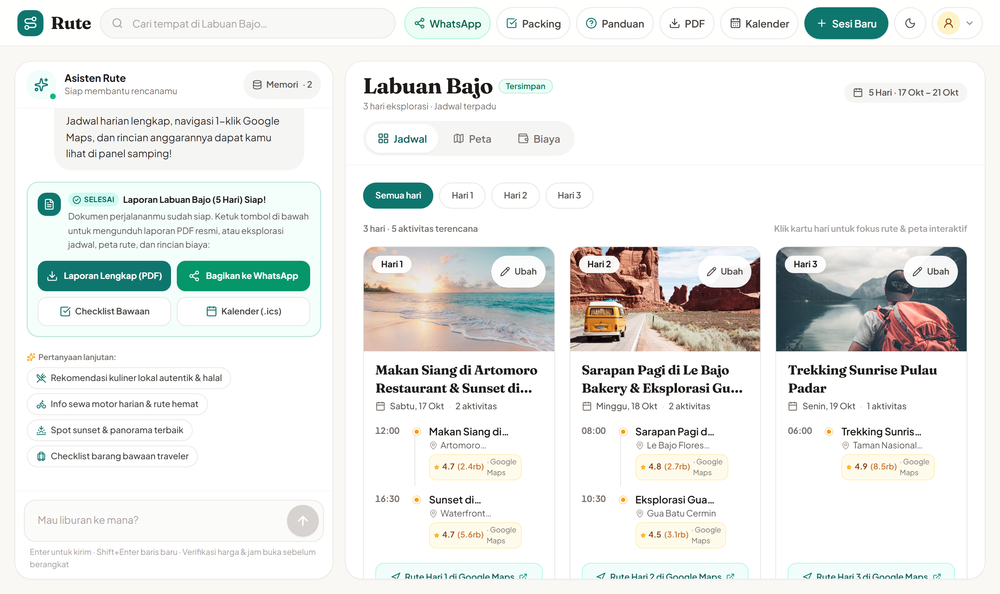
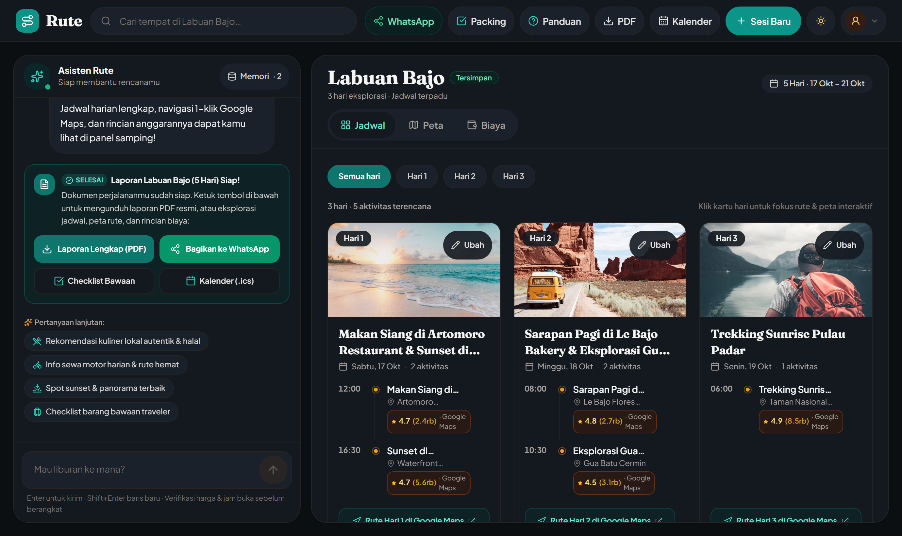
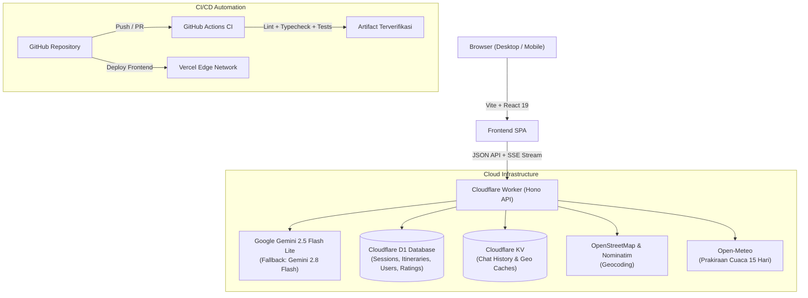

# Rute — AI Travel Planner

[](https://github.com/NAxel-code/AI-Travel-Chatbot/actions/workflows/ci.yml)
[](https://nodejs.org/)
[](https://workers.cloudflare.com/)
[](https://react.dev/)
[](https://tailwindcss.com/)

Perencana perjalanan cerdas berbahasa Indonesia yang mengubah percakapan natural menjadi itinerary multi-hari yang terstruktur, realistis, dan siap jalan. Didukung oleh **Google Gemini AI**, basis data geospasial **Google Maps & OpenStreetMap**, prakiraan cuaca **Open-Meteo**, kalkulator transparansi anggaran, serta penyimpanan cloud **Cloudflare D1 & KV**.

---

## 📸 Tampilan Antarmuka Terbaru (UI Showcase)

Aplikasi dirancang dengan estetika editorial **Hallmark** dan panduan **UI-UX-Pro-Max** bebas dari *AI-slop*, menghadirkan pengalaman taktil yang nyaman baik di mode terang maupun gelap.

### 1. Tema Terang (Sand & Sea Palette)

*Tampilan desktop mode terang (`#faf8f4`): Navigasi aksi cepat, kartu harian terstruktur dengan rating Google Maps asli, navigasi 1-klik, dan panel konsultasi asisten AI.*

### 2. Tema Gelap (Obsidian Dark Palette)

*Tampilan desktop mode gelap obsidian (`#0c0f12`): Kontras tinggi (4.5:1+), ramah mata untuk perencanaan malam hari, dilengkapi indikator memori dan ekspor laporan terpadu.*

---

## ✨ Fitur & Kemampuan Utama

### 1. Asisten AI Konsultatif & Streaming Cepat
- **Server-Sent Events (SSE)**: Respon Gemini dan indikator tahapan proses (*grounding tempat, estimasi cuaca, kalkulasi rute*) dialirkan secara bertahap dalam hitungan milidetik tanpa membekukan antarmuka.
- **Deteksi Konteks Cerdas**: Mengenali destinasi, durasi hari, peserta, dan preferensi gaya traveling (hemat, kuliner halal, ramah anak, backpacker).
- **Penyesuaian Hari Tertentu**: Pengguna dapat meminta perubahan spesifik per hari (misal: *"Ubah jadwal hari ke-2 untuk aktivitas indoor karena hujan"*).

### 2. Grounding Tempat Nyata & Rating Google Maps
- **Data Geospasial Terkurasi**: Ratusan tempat wisata dan kuliner nyata di Indonesia dengan koordinat lintang/bujur presisi.
- **Rating & Ulasan Publik**: Setiap kartu aktivitas menampilkan bintang rating asli (*Google Maps*) dan jumlah ulasan.
- **Navigasi 1-Klik**: Tombol langsung untuk membuka rute *turn-by-turn* di aplikasi Google Maps ponsel.
- **Anti-Repetisi Kuliner**: Menjamin variasi tempat makan yang berbeda di setiap waktu makan tanpa duplikasi membosankan.

### 3. Toggle Tema Terang & Gelap (Obsidian Palette)
- **Dua Palet Warna Terkurasi**: *Sand & Sea* (Alabaster hangat) dan *Obsidian Dark* (`#0c0f12`, `#141920`, `#1a212b`).
- **Persistensi Otomatis**: Mendeteksi preferensi sistem pengguna (`prefers-color-scheme`) dan menyimpan pilihan manual di `localStorage`.
- **Rasio Kontras WCAG AA**: Memenuhi standar keterbacaan minimal 4.5:1 di seluruh kartu, tombol, teks, dan modal.

### 4. Tur Spotlight Interaktif di Layar (*On-Screen Walkthrough*)
- **Native Spotlight Cutout**: Panduan langsung di layar menggunakan efek *box-shadow cutout* dinamis dan *pulsing beacon* tanpa library pihak ketiga yang berat.
- **5 Langkah Panduan**:
  1. *Chat Composer AI* — Konsultasi dan ceritakan liburan impian.
  2. *Workspace Terpadu* — Membaca jadwal harian dan jam aktivitas.
  3. *Kalkulator Biaya* — Transparansi anggaran (penginapan, sewa motor, makan, tiket).
  4. *Peta Rute* — Visualisasi jalur geografis dan navigasi turn-by-turn.
  5. *Aksi Offline* — Ekspor dokumen PDF, Kalender (.ics), dan WhatsApp.
- **Mobile Responsive**: Otomatis berpindah tab mobile sebelum menyorot elemen agar target tidak terpotong.
- **Aksesibilitas Penuh**: Navigasi keyboard (`Esc`, `Enter`, `←`/`→`) dan status selesai tersimpan.

### 5. Kalkulator Biaya & Transparansi Anggaran
- Rincian estimasi biaya perjalanan: tiket transportasi PP, penginapan per malam, sewa motor & BBM harian, konsumsi 3x sehari, dan tiket masuk wisata.
- Pilihan mode budget dinamis: **Hemat**, **Standar**, dan **Nyaman**, serta penyesuaian jumlah peserta secara instan.

### 6. Bawa Perjalanan Offline & Berbagi
- **Laporan Perjalanan PDF**: Ekspor dokumen resmi siap cetak lengkap dengan ringkasan rute, kontak darurat, dan estimasi biaya.
- **Sinkronisasi Kalender (.ics)**: Ekspor jadwal aktivitas terstruktur (durasi 90 menit) langsung ke Google Calendar atau Apple Calendar sesuai zona waktu destinasi (WIB/WITA/WIT).
- **1-Klik Berbagi WhatsApp**: Memformat rute harian menjadi pesan chat rapi siap kirim ke rekan seperjalanan.
- **Checklist Bawaan (Packing List)**: Rekomendasi barang bawaan dinamis yang disesuaikan dengan jenis destinasi (pantai vs gunung) dan durasi hari.

### 7. Akun & Multi-Session Terpadu
- Mendukung mode anonim instan serta login/register akun untuk menyimpan riwayat perjalanan multi-perangkat di Cloudflare D1.

---

## 🏗️ Arsitektur Sistem



---

## 📁 Struktur Direktori

```text
├── .github/
│   └── workflows/
│       └── ci.yml                     # Pipeline CI otomatis (Backend & Frontend)
├── backend/
│   ├── migrations/                    # File migrasi database D1
│   ├── src/
│   │   ├── agent-tools.ts             # Definisi & eksekusi tool agen Gemini
│   │   ├── ai.ts                      # Konfigurasi model Gemini, system prompt, & function schemas
│   │   ├── auth.ts                    # Handler registrasi, login, logout, & akun pengguna
│   │   ├── chat.ts                    # Orkestrasi SSE chat, model fallback, & tool calling
│   │   ├── index.ts                   # Entrypoint router Hono & middleware CORS
│   │   ├── itinerary.ts               # Handler pengambilan & manajemen itinerary D1
│   │   ├── session.ts                 # Manajemen sesi, token hash, rate limiter, & preferensi
│   │   ├── travel-data.ts             # Kurasi dataset tempat wisata Indonesia, OSM, & cuaca
│   │   ├── types.ts                   # Definisi tipe TypeScript backend
│   │   └── validation.ts              # Validasi schema, UUID, & format tanggal
│   ├── schema.sql                     # Skema inisialisasi basis data Cloudflare D1
│   └── wrangler.toml                  # Konfigurasi binding Cloudflare Workers
├── docs/
│   ├── rute-ui.png                    # Bukti tampilan terbaru (Mode Terang)
│   └── rute-ui-dark.png               # Bukti tampilan terbaru (Mode Gelap Obsidian)
├── frontend/
│   ├── src/
│   │   ├── components/
│   │   │   ├── AuthModal.tsx          # Modal login & registrasi akun
│   │   │   ├── DayCard.tsx            # Kartu jadwal harian, foto, rating, & link Google Maps
│   │   │   ├── ExpensesView.tsx       # Tampilan kalkulator biaya & mode budget
│   │   │   ├── Markdown.tsx           # Renderer markdown aman bebas raw HTML
│   │   │   ├── Navbar.tsx             # Bilah navigasi, toggle tema, & tombol aksi
│   │   │   ├── PackingListModal.tsx   # Modal interaktif checklist barang bawaan
│   │   │   ├── SpotlightTour.tsx      # Walkthrough spotlight interaktif di layar
│   │   │   ├── TravelMap.tsx          # Peta Leaflet/Google Maps dengan isolasi rute per hari
│   │   │   └── TutorialModal.tsx      # Modal panduan komprehensif & contoh prompt
│   │   ├── lib/
│   │   │   ├── calendar.ts            # Parser & generator RFC iCalendar (.ics)
│   │   │   ├── sse.ts                 # Parser Server-Sent Events tahan chunk terpotong
│   │   │   └── travelReport.ts        # Generator dokumen PDF laporan perjalanan
│   │   ├── App.tsx                    # Komponen utama state & integrasi workspace
│   │   └── index.css                  # Tema Tailwind CSS, token Obsidian, & Sand & Sea
│   └── vercel.json                    # Konfigurasi routing & serverless build Vercel
└── README.md
```

---

## ⚡ Prasyarat & Menjalankan Lokal

### Prasyarat
- **Node.js**: Versi 24 atau lebih baru
- **Cloudflare Wrangler CLI**: Untuk manajemen basis data D1 lokal
- **Google Gemini API Key**: Kunci API untuk pemanggilan LLM

### 1. Menjalankan Backend (Cloudflare Worker)
```powershell
cd backend
npm install
Copy-Item .dev.vars.example .dev.vars
# Isi GEMINI_API_KEY pada file .dev.vars

# Inisialisasi skema basis data lokal
npx wrangler d1 execute travel-db --local --file=schema.sql

# Jalankan server development (Port 8787)
npm run dev
```

### 2. Menjalankan Frontend (React + Vite)
```powershell
cd frontend
npm install
Copy-Item .env.example .env.local

# Jalankan dev server (Port 5173)
npm run dev
```
Buka browser di `http://localhost:5173`. Aplikasi otomatis terhubung ke backend lokal `http://localhost:8787/api`.

---

## 🧪 Verifikasi & Pengujian Mutu

Sebelum melakukan *push*, jalankan seluruh rangkaian uji otomatis berikut:

```powershell
# Pengecekan Backend
cd backend
npm run check                          # TypeScript type check (tsc --noEmit)
npm test                               # Unit tests (Auth & Input Validation)
npx wrangler deploy --dry-run          # Verifikasi bundle Cloudflare Worker

# Pengecekan Frontend
cd ../frontend
npm run lint                           # Linter cepat (oxlint)
npm test                               # Unit tests (SSE Stream Parser & Calendar Generator)
npm run build                          # Build kompilasi produksi Vite
```

Seluruh pengujian di atas juga dijalankan secara otomatis di lingkungan GitHub Actions pada setiap *pull request* dan *push ke branch main*.

---

## 🌐 Daftar Endpoint API

Semua endpoint privat mewajibkan header `X-Session-Token` atau `X-Auth-Token`.

| Method | Endpoint | Fungsi |
|---|---|---|
| `GET` | `/` | Health check layanan API. |
| `POST` | `/api/session` | Membuat sesi baru atau mengklaim sesi anonim. |
| `POST` | `/api/auth/register` | Mendaftarkan akun pengguna baru. |
| `POST` | `/api/auth/login` | Autentikasi akun & mendapatkan auth token. |
| `POST` | `/api/auth/logout` | Mengakhiri sesi akun pengguna. |
| `GET` | `/api/auth/me` | Mengambil profil akun pengguna aktif. |
| `GET` | `/api/trips` | Mengambil riwayat perjalanan tersimpan milik akun. |
| `POST` | `/api/chat` | Mengirim pesan konsultasi; merespons via Server-Sent Events (SSE). |
| `GET` | `/api/history/:session_id` | Mengambil riwayat percakapan sesi (maks. 20 pesan). |
| `GET` | `/api/itinerary/:session_id` | Mengambil data itinerary terstruktur terbaru. |
| `GET` | `/api/preferences/:session_id` | Mengambil preferensi yang diingat sistem. |
| `DELETE` | `/api/preferences/:session_id/:category` | Menghapus preferensi tertentu dari memori. |

---

## 📄 Lisensi & Batasan

- **Keamanan & Rate Limiting**: Dilengkapi pembatasan frekuensi pesan (*fixed-window rate limiting*) di D1 (12 pesan/sesi/menit).
- **Data Eksternal**: Koordinat dan prakiraan cuaca dicache secara cerdas di Cloudflare KV untuk mematuhi kebijakan penggunaan wajar (*fair use policy*) Nominatim OpenStreetMap dan Open-Meteo.
- **Verifikasi Real-Time**: Harga tiket masuk, ketersediaan hotel, jam operasional, dan tiket wahana dapat berubah sewaktu-waktu sesuai kondisi lapangan dan dianjurkan diverifikasi kembali sebelum keberangkatan.
